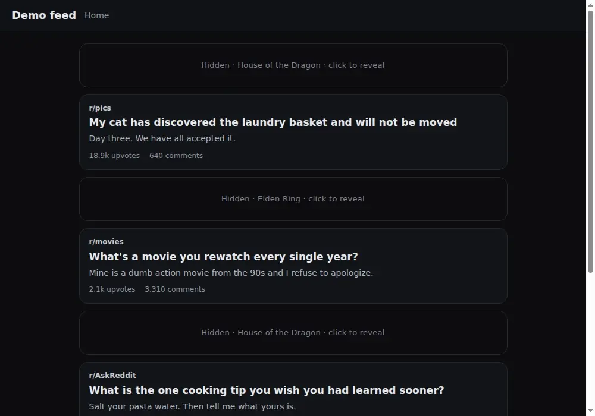
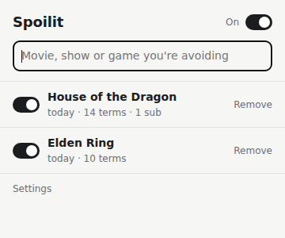

# Spoilit

Hide Reddit posts and comments about the movie, show or game you haven't caught up on, without muting whole communities.

**[Try it in your browser](https://spoilit.soleone.xyz)**: the extension's own scripts on a simulated feed, so no install, no account, and nothing reaches Reddit.



Hidden items show as dark bars. Click one to reveal it. The toolbar badge counts what's hidden on the tab.

## Try it

```sh
git clone https://github.com/Soleone/spoilit && cd spoilit
npm install
npm run demo
```

This opens Chromium with the real extension loaded, two sample topics and a synthetic Reddit feed, so there is no account and nothing touches reddit.com. It needs a Chromium build that still accepts `--load-extension` (Google Chrome stable does not); set `CHROME_BIN` to pick one. `npm run demo:web` builds the same feed as a static page in `dist/web`, with a strip of controls standing in for the toolbar popup.

## Install

There is no build step. The extension is plain JavaScript loaded as is.

1. Open `chrome://extensions`.
2. Turn on **Developer mode** (top right).
3. Click **Load unpacked** and pick this folder.
4. Pin the Spoilit icon from the puzzle-piece menu so the popup is one click away.

After editing a file, click the reload icon on the extension's card, then reload open Reddit tabs.

## Use



1. Click the icon and type a title. Pick a result, or "Just hide posts that say ..." for a plain keyword.
2. Spoilit looks the topic up once (a few seconds to a minute) and saves the terms it finds.
3. Browse Reddit as usual.

Comments are checked one by one, so a comment naming a character gets hidden anywhere. On the page of a post that matched, the whole comment section is covered too, since most replies never name anything.

In the popup you can switch topics on and off, pause everything, edit the term and subreddit lists, look a topic up again, or remove it. **Settings** has the comment-hiding toggle, a test box to see what a piece of text would match, and an optional Claude API key.

## How it finds terms

When a topic is added, `background.js` collects terms from:

- **Wikidata**: titles, aliases, sequels and parts, characters, cast, episode titles and official subreddits.
- **The topic's Fandom wiki**: page titles such as characters, places, bosses and items. Spoilit uses the wiki listed on Wikidata, or guesses one and checks that it really covers the topic.
- **Claude (optional)**: only if an API key is set in Settings. Without a key, "Copy chatbot prompt" lets you ask any chatbot and paste its reply back in.

Single common words ("hopper", "rose", "finale") are dropped using `words.js`, so they only count as part of a longer name.

The matcher (`match.js`) is whole-word, ignores case and accents, and lets phrase parts be joined by spaces, punctuation or nothing, so "House of the Dragon" also catches `#HouseOfTheDragon`. Short abbreviations like "GoT" match exact case so they don't fire on "got". Cost depends on the length of a post, not on how many thousand terms a topic has.

## Privacy

Terms are saved in `chrome.storage.local` and never refreshed automatically. Matching on Reddit is fully local and makes no network requests. The only requests go to Wikidata and Fandom when you add or look up a topic, and to Anthropic if you add an API key, which stays in this browser.

## Develop

| Command | What it does |
| --- | --- |
| `npm test` | Unit tests for the matcher and term parsing (Node 22+, no dependencies) |
| `npm run demo` | The demo above |
| `npm run demo:web` | Builds the hosted demo into `dist/web` |
| `npm run media:capture` | Re-records `docs/media` from the demo (needs agent-browser and FFmpeg) |
| `npm run package` | Zips the extension into `dist/` for the Chrome Web Store |

| File | What it does |
| --- | --- |
| `manifest.json` | Extension manifest (MV3) |
| `background.js` | Service worker: topic storage, lookups, badge |
| `sources.js` | Wikidata, Fandom and Claude lookups |
| `match.js` | Keyword matcher shared by every page |
| `words.js` | Common words and first names to ignore on their own (generated, edit the `Set` directly) |
| `content.js`, `content.css` | Hides and reveals items on reddit.com |
| `popup.*`, `options.*`, `ui.css` | Toolbar popup, settings page and shared styles |
| `demo/`, `scripts/` | Demo feed, hosted build, media capture and packaging |
| `test/` | Tests |

`words.js` was built from the 10,000 most common English words ([google-10000-english](https://github.com/first20hours/google-10000-english)), the 1,200 most common US first names, and a hand-written list of words used about any show or game.

## Limits

- Images and memes with no matching text get through, unless they're posted in a subreddit on the topic's list.
- Matching is aggressive, so some unrelated posts get hidden too. They're one click away.
- Reddit's markup changes now and then; the selectors live at the top of `content.js`.

## License

[MIT](LICENSE)
